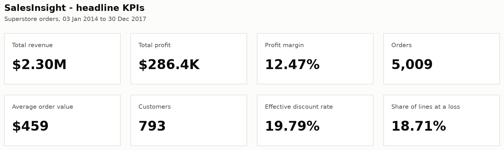
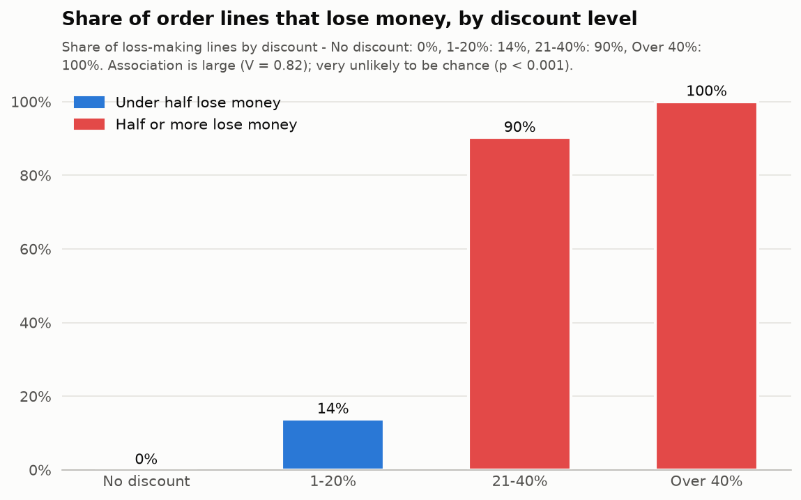
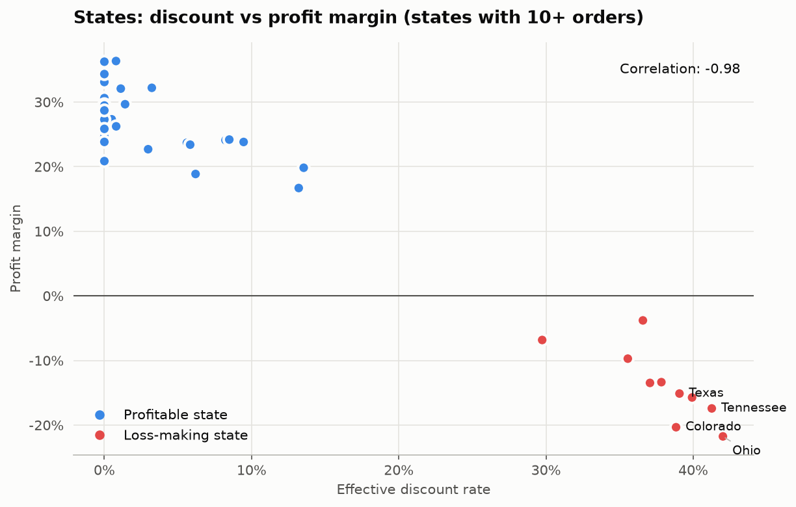
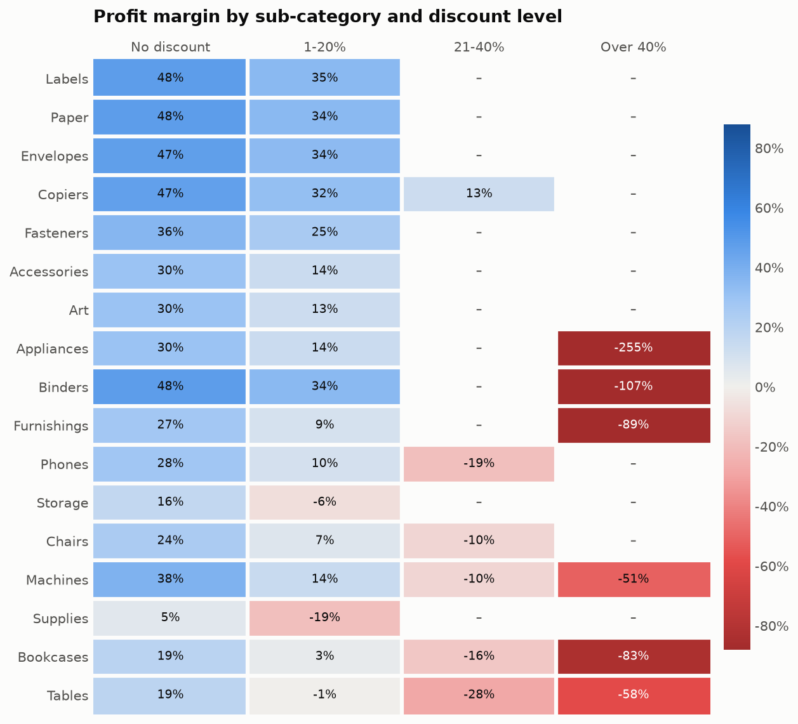
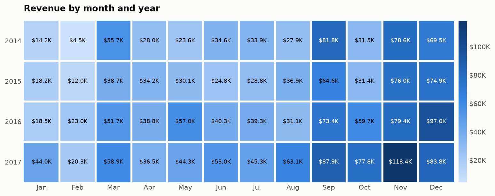
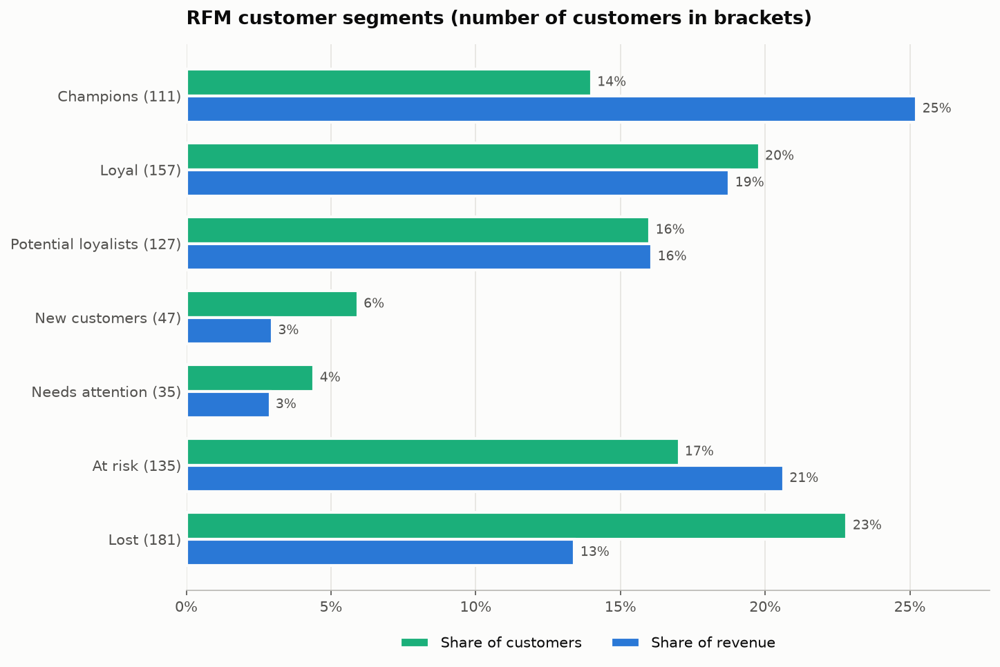
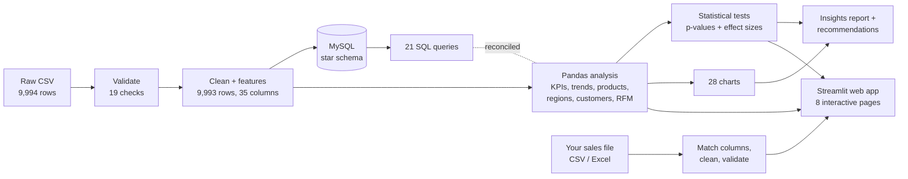

# SalesInsight – Business Sales Analytics and Intelligence Platform

An end-to-end sales analytics project that turns ~10,000 raw retail order lines into tested, reproducible business insights, using **Python, Pandas, NumPy, SQL (MySQL), statistics, Matplotlib, Seaborn, Streamlit and Plotly**.

One command validates and cleans the data, loads a MySQL star schema, runs 21 SQL queries, analyses revenue, trends, products, regions and customers, tests every pattern statistically, and writes a business report with prioritised recommendations.

```
python scripts/run_pipeline.py
```

**Full report:** [reports/insights_report.md](reports/insights_report.md)

**Live app:** [salesinsight-kalai.streamlit.app](https://salesinsight-kalai.streamlit.app/) (the first visit after a quiet period can take a minute while the app wakes up)

**Interactive web app:** an 8-page BI dashboard (Streamlit + Plotly) with global filters, period comparisons, automated insights and CSV/report downloads - see [Web app](#web-app).

**Bring your own data:** upload any business's sales file (CSV or Excel). SalesInsight matches its columns, cleans and checks it, and every page adapts to what the file contains - see [Analyse your own sales file](#analyse-your-own-sales-file).

---

## Key findings

| | |
|---|---|
| **Revenue** | **$2.30M** over 2014-2017, growing **14.9% a year** (CAGR) |
| **Profit** | **$286.4K**, a **12.5%** margin |
| **Discounts** | **$566.6K** given away (19.8% of list price); **18.7%** of order lines lose money, **-$156.1K** in total |
| **Regions** | **10 states lose money** (-$98.2K). Across states, discount rate and margin correlate at **-0.98** |
| **Categories** | Technology and Office Supplies earn ~17% margins; **Furniture only 2.5%**, with **1 in 3 lines at a loss** at the same ~20% discount |
| **Seasonality** | **November** is the peak month (index 184); **Q4 = 38.2%** of yearly revenue |
| **Customers** | **98.5%** buy again; 2017 retention **87.5%**; but **99%** of 2017 revenue came from returning customers - few new ones |
| **RFM** | **135 "At risk"** customers (once frequent, now inactive) hold **20.6%** of revenue |



### Deep discounts go with losses

Lines with bigger discounts lose money far more often. The link is statistically tested (chi-square test, Spearman correlation) and also appears across states.





### Where the losses are



### Seasonality



### Customer segments (RFM)



## Recommendations

Generated by rules from the data (see [the report](reports/insights_report.md) for evidence and impact estimates):

1. **Cap discounts at 20%** and require approval above it - deep discounts are where losses concentrate.
2. **Change the discount policy in the 10 loss-making states** (Texas, Ohio, Pennsylvania, Illinois, ...).
3. **Reprice the loss-making sub-categories** (listed in the report) and raise the **Furniture** margin.
4. **Win back the 135 "At risk" customers** before they become lost.
5. **Grow the West** (fastest-growing, best margin) and repair **Central** (lowest margin, highest discount).
6. **Plan stock and staff for the Q4 peak**; use margin-safe promotions in February.
7. **Invest in new-customer acquisition** - growth currently relies almost entirely on existing customers.

A statistical check also prevents a wrong conclusion: average order value fell from $499 (2014) to $435 (2017), but the **95% bootstrap confidence intervals overlap**, so the report does not claim a certain decline.

---

## What the project does



| Phase | What | Main files |
|---|---|---|
| 1 | Environment, config, logging, setup check | `config.py`, `logger.py`, `scripts/check_setup.py` |
| 2 | Load + 19 data-quality checks + data dictionary | `data_loader.py`, `validation.py` |
| 3 | Cleaning (duplicates, postal codes, product keys) + 14 new columns | `cleaning.py`, `features.py` |
| 4 | MySQL star schema, transactional load, 21 SQL queries, SQL = pandas reconciliation | `star_schema.py`, `database.py`, `sql/` |
| 5 | Revenue and profit KPIs (Q1) | `kpis.py` |
| 6 | Monthly/yearly trends, moving average, YoY, seasonality, CAGR (Q2) | `trends.py` |
| 7 | Best sellers, Pareto 80/20, categories, discount vs margin (Q3, Q4) | `products.py` |
| 8 | Regions, states, region x category (Q5) | `regions.py` |
| 9 | Segments, repeat rate, retention, RFM segmentation (Q6) | `customers.py` |
| 10 | Hypothesis tests, effect sizes, bootstrap confidence intervals | `stats_tests.py` |
| 11 | Insights report and rule-based recommendations (Q7) | `insights.py` |
| 12 | One-command pipeline, README | `scripts/run_pipeline.py` |
| 13 | Interactive web app (Streamlit + Plotly), online deployment | `app/`, `filtering.py`, `dashboard_data.py` |
| 14 | Upload your own sales file: column matching, cleaning, validation, pages that adapt | `upload/`, `app/views/data_source.py`, `app/components/caps.py` |

## Technical highlights

- **Data quality first:** 19 automated checks (schema, missing values, duplicates, date logic, value ranges, ID consistency). Found and fixed a duplicate record, 438 postal codes that had lost their leading zero, and 32 Product IDs shared by different products (handled with a surrogate `product_key`).
- **Star schema in MySQL:** `fact_sales` + `dim_customer`, `dim_product`, `dim_location`; `DECIMAL` for money; foreign keys and indexes; the whole load runs in one transaction and rolls back on failure.
- **Reconciliation:** row count, revenue, profit, quantity, orders and customers in MySQL must match pandas exactly, or the pipeline stops.
- **Correct metrics:** average order value divides by distinct orders (not rows); growth after a $0 month is left blank; seasonality uses complete years only; RFM ties always get the same score.
- **Statistics done properly:** non-parametric tests for skewed sales data, effect sizes next to every p-value (with 10,000 rows, tiny differences become "significant"), reproducible bootstrap intervals.
- **Accessible charts:** one fixed colour-blind-checked palette (revenue = blue, profit = orange, customers = green), red/blue diverging scale for losses vs profits, one y-axis per chart.
- **Interactive app built on the same tested code:** the dashboard reuses the analysis modules (no hard-coded numbers); every filter and chart switch recalculates from the cleaned data; parts that cannot be calculated for a small selection are skipped and listed instead of crashing the page.
- **Works on other businesses' data:** uploaded files are matched to a standard sales schema (21 fields, many common column names), parsed robustly (₹/$/€, Indian number grouping, day/month vs month/day dates, Excel dates) and validated with a plain-language report. Each file gets a list of capabilities (profit, customers, regions, ...) and charts or advice it cannot support are hidden, never shown with misleading zeros.
- **Privacy by design:** an uploaded file lives only in that visitor's session - never written to disk, never in the shared cache, gone when the tab closes.
- **Tested:** 490+ pytest tests with hand-calculated expected values; database tests run on SQLite so no MySQL server is needed.
- **Lightweight:** CPU only, runs in seconds, well under 1 GB of RAM.

## Tech stack

| Area | Tools |
|---|---|
| Language | Python 3.10+ |
| Data | pandas, NumPy |
| Database | MySQL 8, SQLAlchemy 2, PyMySQL |
| Statistics | SciPy |
| Visualisation | Matplotlib, Seaborn (report charts), Plotly (web app) |
| Web app | Streamlit (Community Cloud) |
| Testing | pytest |
| Config | python-dotenv |

## Project structure

```
SalesInsight/
├── data/
│   ├── raw/                  Superstore.csv (download from Kaggle; not in Git)
│   ├── processed/            sales_clean.csv (generated)
│   └── samples/              example files to try the upload feature (synthetic)
├── sql/                      01_create_database.sql, 02_create_tables.sql, 03_analysis_queries.sql
├── app/                      Streamlit web app (streamlit_app.py, components/, views/, assets/)
├── src/salesinsight/         all analysis code (one module per topic)
│   └── upload/               read, match, clean and validate uploaded sales files
├── scripts/                  one runnable script per phase + run_pipeline.py
├── tests/                    pytest suite
├── reports/
│   ├── figures/              charts (PNG)
│   ├── tables/               result tables (CSV)
│   └── insights_report.md    the business report
├── .env.example              MySQL settings template (real .env is not in Git)
├── pyproject.toml
└── requirements.txt
```

## How to run it

**Requirements:** Python 3.10+, MySQL 8 (optional - use `--skip-database` without it).

```powershell
# 1. Get the code and install
git clone https://github.com/Kalai-coder-DS/SalesInsight.git
cd SalesInsight
py -m venv .venv
.\.venv\Scripts\python.exe -m pip install -r requirements.txt
.\.venv\Scripts\python.exe -m pip install -e .

# 2. Add the data
#    Download "Superstore Dataset" (vivek468) from Kaggle and save it as data/raw/Superstore.csv

# 3. MySQL settings (skip if you use --skip-database)
copy .env.example .env      # then put your MySQL password in .env

# 4. Run everything
.\.venv\Scripts\python.exe scripts\run_pipeline.py --with-tests
```

On macOS/Linux use `python3 -m venv .venv`, `source .venv/bin/activate` and `cp .env.example .env`.

## Web app

Eight pages: **Data Source**, **Executive Overview, Sales Trends, Product Intelligence, Regional Intelligence, Customer Intelligence, Business Insights** and a **Data Explorer**.

- Global sidebar filters (year, date range, region, state, category, sub-category, segment) apply to every page; state and sub-category options follow the region and category chosen.
- KPI cards compare with the previous period (the same months one year earlier, or an equal number of days for a custom range).
- Chart switches change the actual chart (bar, horizontal bar, pie, donut, treemap, sunburst, line, area, heatmap, US map, waterfall, Pareto).
- Business Insights runs the Phase 10-11 statistics and recommendation rules on the filtered data.
- Downloads: filtered order lines, summaries, loss-makers, recommendations (CSV) and the insights report (Markdown).
- Dark theme with an optional light mode for the page area.

Run it locally (after step 2 above):

```powershell
.\.venv\Scripts\python.exe -m streamlit run app/streamlit_app.py
```

**Online version:** the dataset is not stored in this repository. On Streamlit Community Cloud the app downloads it from Kaggle at start-up, using a Kaggle API key kept in the app's Secrets (`KAGGLE_USERNAME`, `KAGGLE_KEY`). The online app installs only `app/requirements.txt`.

## Analyse your own sales file

On the **Data Source** page, choose *My own sales file*:

1. **Upload** a CSV or Excel (.xlsx) file - up to 20 MB and 200,000 rows, one row per sale or order line.
2. **Preview** the first rows. Files that are not sales data (no dates or amounts) are explained, not analysed.
3. **Match your columns.** SalesInsight suggests a match for each field from the column names *and* the values (for example *Bill Date* -> order date, *Amount (₹)* -> sales). Only the **order date** and the **sales amount** are needed (or unit price and quantity); everything else unlocks more analysis.
4. **Check & analyse.** A data check lists every fix (rows without a date removed, "10%" read as 0.10, ...) and which analyses the file supports.

All pages then show the uploaded data, in its currency. Charts and recommendations that need missing fields are replaced by a short note such as *"Add a profit or cost column"*; the sidebar shows only the filters the file has. *Use demo data* switches back at any time.

| What your file has | What you get |
|---|---|
| Date + amount | Revenue KPIs, trends, seasonality, weekdays, best sellers (with a product column) |
| + order ID / customer | Orders, average order value, repeat customers, RFM, customer recommendations |
| + profit or cost | Margins, loss-makers, profit waterfall, pricing recommendations |
| + discount, category, region, state | Discount analysis, category and regional views, US map (for US states) |

**Try it:** `data/samples/` holds three example files with different column names and formats (an Indian retailer in ₹ with day/month dates, an online store in Excel with cost instead of profit, a café with only price and quantity) - also downloadable on the Data Source page. `scripts/make_sample_uploads.py` recreates them.

**Privacy:** the file is kept only in your browser session. It is not saved, not shared with other visitors and disappears when you close the tab or click *Remove my file*.

## Dataset

[Superstore Dataset](https://www.kaggle.com/datasets/vivek468/superstore-dataset-final) on Kaggle: 9,994 order lines of a US retailer, 2014-2017, 21 columns (orders, customers, products, locations, sales, quantity, discount, profit). The dataset is a public sample; findings describe this data, not a specific real company.

## Limitations

- No cost breakdown in the data, so low margins cannot be split into supplier, shipping or return costs.
- Discounts and losses are strongly associated, but proving how much a discount cap would recover needs a controlled pricing test.
- Impact estimates in the report are upper bounds that assume sales volume stays the same.
- Uploaded files: one table per file (no joining of several files), `.xls` must be saved as `.xlsx`, the US map works for US state names only, and amounts are shown in one currency (no conversion).

## Author

**Kalaiyarasi** - [GitHub](https://github.com/Kalai-coder-DS)
