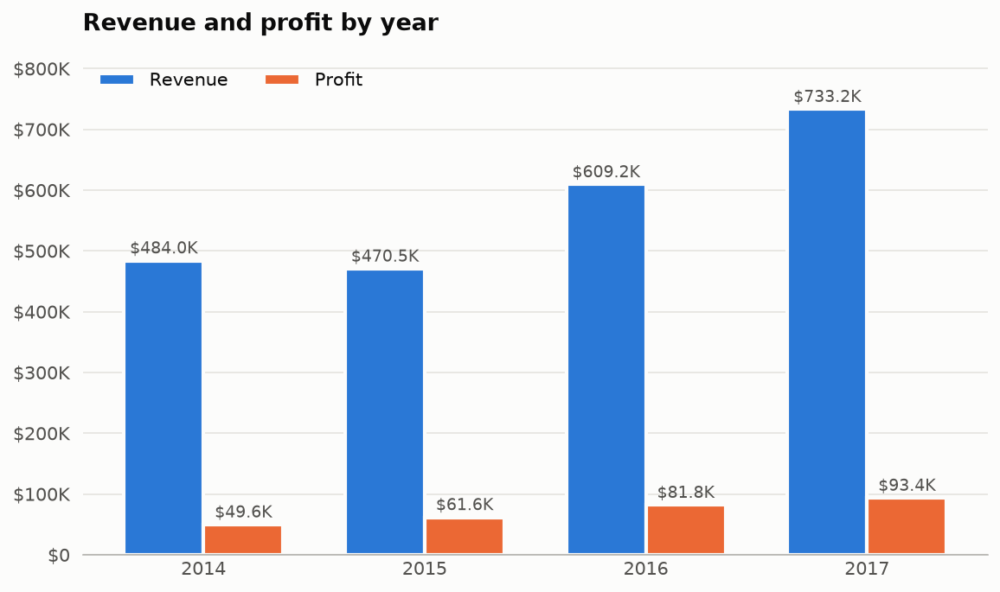
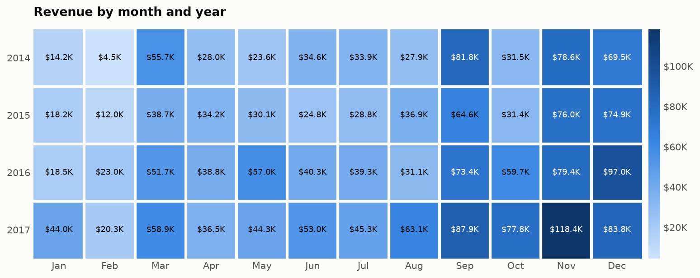
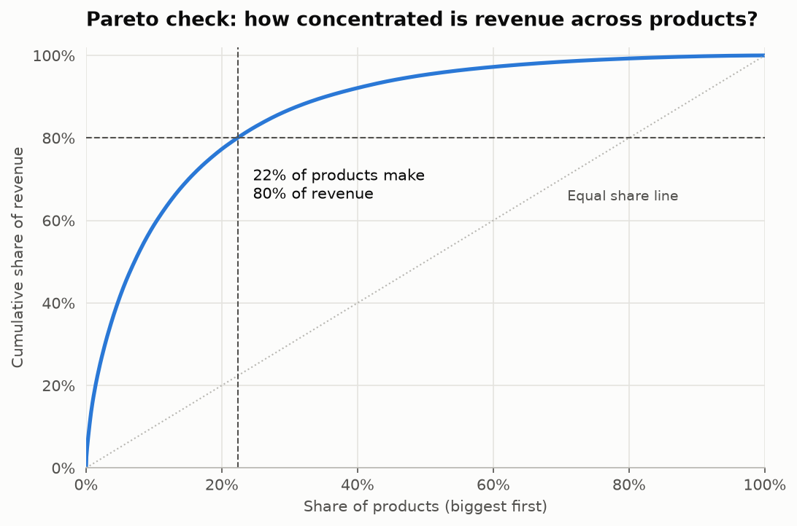
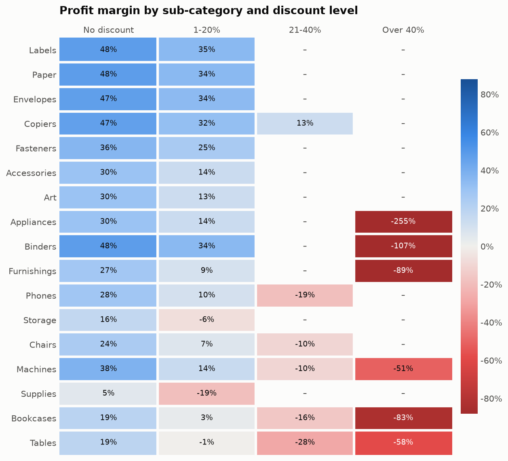
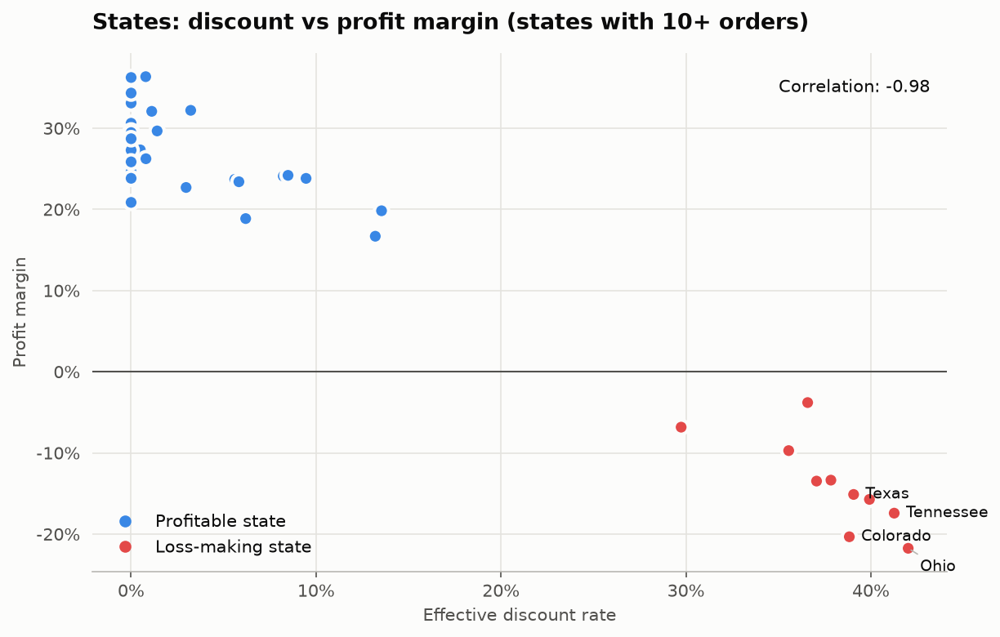
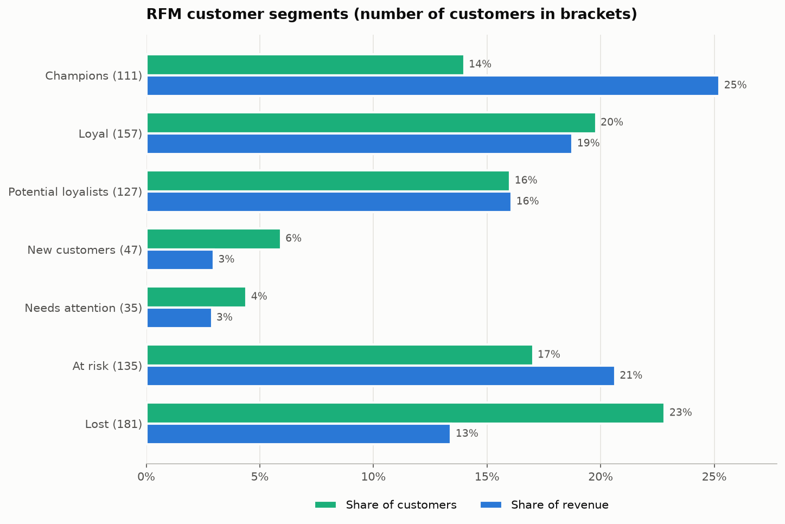
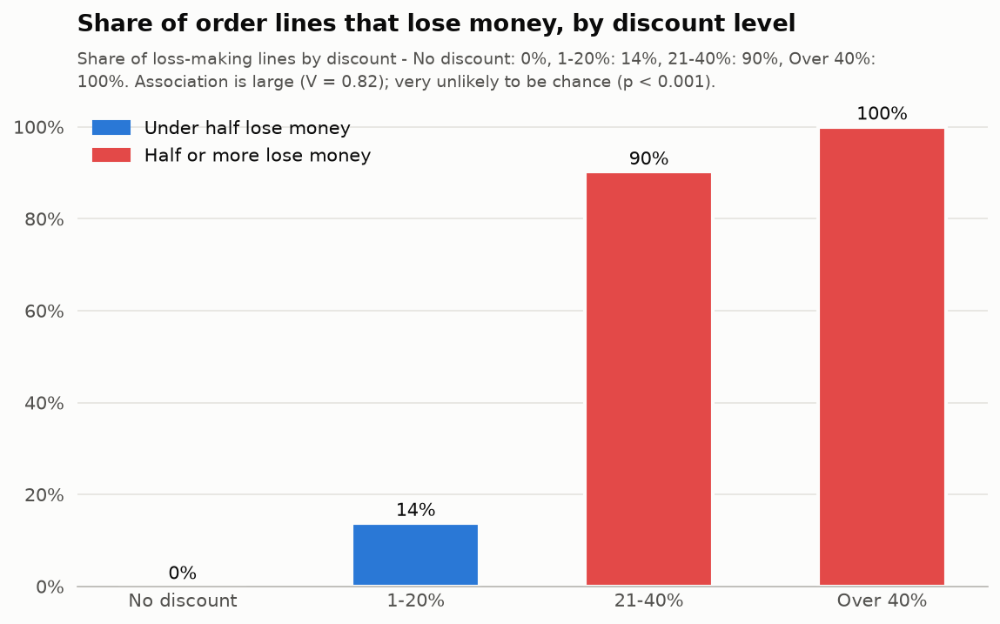

# SalesInsight - Business Insights Report

Superstore sales, 03 Jan 2014 to 30 Dec 2017. 5,009 orders, 793 customers, 1,894 products. All figures are generated from the cleaned data by `scripts/run_insights.py`.

## Executive summary

- **Revenue $2,296,919.49, profit $286,409.08 (12.5% margin).** Revenue grew 14.9% a year (2014-2017).
- **Discounts are the main profit leak.** $566,613.59 was given away (19.8% of list price); 18.7% of order lines lose money, -$156,119.23 in total.
- **10 states lose money** (-$98.2K), and the states that discount more earn less (correlation -0.98).
- **Sales are seasonal:** Nov is the peak month and Q4 brings 38.2% of revenue.
- **Customers are loyal** (98.5% buy again), but few new customers arrive.

## Top recommendations

| # | Area | Recommendation | Impact |
| --- | --- | --- | --- |
| 1 | Pricing | Cap discounts at 20% and require approval above it | Up to $138.5K of losses would be avoided if those lines were sold at 20% or less, or not sold at a loss. |
| 2 | Regions | Change the discount policy in the loss-making states | Bringing these states to break-even adds $98.2K profit. |
| 3 | Products | Fix or reprice the loss-making sub-categories | Bringing these sub-categories to break-even adds $22.4K profit. |
| 4 | Products | Raise the Furniture margin | Each extra percentage point of margin on Furniture adds about $7.4K profit on the same sales. |
| 5 | Customers | Win back the 'At risk' customers | Winning back a quarter of them protects about $118.5K of revenue. |
| 6 | Regions | Grow West and repair Central | Lifting Central to the company margin of 12.5% adds about $22.8K profit. |
| 7 | Planning | Plan stock, staff and marketing around the Q4 peak | Fewer stock-outs in the peak and better use of capacity in quiet months. |
| 8 | Customers | Invest in finding new customers | Reduces dependence on the existing customer base and creates the next group of loyal customers. |
| 9 | Customers | Raise average order value with bundles | Each $10 on average order value is worth about $12.5K a year at current order volume. |

## 1. Revenue and profit (Q1)

| Year | Revenue | Profit | Margin | Orders | Revenue growth |
| --- | --- | --- | --- | --- | --- |
| 2014 | $484.0K | $49.6K | 10.2% | 969 | - |
| 2015 | $470.5K | $61.6K | 13.1% | 1038 | -2.8% |
| 2016 | $609.2K | $81.8K | 13.4% | 1315 | +29.5% |
| 2017 | $733.2K | $93.4K | 12.7% | 1687 | +20.4% |

Average order value is $458.56; customers buy 7.6 units per order.

## 2. Sales trends (Q2)

- Best month: **Nov 2017** ($118.4K); weakest: Feb 2014 ($4.5K).
- Seasonality: Nov index 184, Feb index 31 (100 = average month).
- Trend line: +903 dollars per month; R-squared 0.25, so seasonality explains much of the month-to-month movement.
- Busiest weekday for orders: Monday.

## 3. Best-selling products (Q3)

- Top product by revenue: **Canon imageCLASS 2200 Advanced Copier** ($61.6K).
- Biggest loss-maker: **Cubify CubeX 3D Printer Double Head Print** (-$8.9K).
- 423 products (22.3%) make 80% of revenue; the top 20% of products make 77.3%.
- 306 products lose money overall (-$77.1K).

## 4. Category performance (Q4)

| Category | Revenue | Profit | Margin | Discount | Lines at a loss |
| --- | --- | --- | --- | --- | --- |
| Technology | $836.2K | $145.5K | 17.4% | 19.5% | 14.7% |
| Furniture | $741.7K | $18.5K | 2.5% | 20.0% | 33.6% |
| Office Supplies | $719.0K | $122.5K | 17.0% | 20.0% | 14.7% |

Best sub-category: Copiers ($55.6K); worst: Tables (-$17.7K). Margin with no discount is 29.5% versus -77.4% with over 40% off.

## 5. Region-wise sales (Q5)

| Region | Revenue | Profit | Margin | Discount |
| --- | --- | --- | --- | --- |
| West | $725.5K | $108.4K | 14.9% | 15.6% |
| East | $678.5K | $91.5K | 13.5% | 19.5% |
| Central | $501.2K | $39.7K | 7.9% | 24.6% |
| South | $391.7K | $46.7K | 11.9% | 21.3% |

Top state: California ($457.7K revenue). Loss-making states: Texas, Ohio, Pennsylvania, Illinois, North Carolina, Colorado, Tennessee, Arizona, Florida, Oregon.

## 6. Customer behaviour (Q6)

- 793 customers; 98.5% ordered more than once; 6.3 orders each; median 129 days between orders.
- Top 10% of customers bring 30.9% of revenue; top 20% bring 48.1%.
- Consumer is the largest segment (50.6% of revenue); Home Office has the best margin.
- Last-year retention 87.5%; returning customers made 99.0% of last year's revenue.

| RFM segment | Customers | Share of customers | Share of revenue |
| --- | --- | --- | --- |
| Champions | 111 | 14.0% | 25.2% |
| Loyal | 157 | 19.8% | 18.8% |
| Potential loyalists | 127 | 16.0% | 16.1% |
| New customers | 47 | 5.9% | 3.0% |
| Needs attention | 35 | 4.4% | 2.9% |
| At risk | 135 | 17.0% | 20.6% |
| Lost | 181 | 22.8% | 13.4% |

## 7. Statistical evidence

Each pattern was tested to check it is not chance. The effect size shows whether it matters in practice.

| Question | Result | Effect | Conclusion |
| --- | --- | --- | --- |
| Do bigger discounts go with lower profit margins? | Significant | large (Spearman rho -0.65) | Higher discounts go with lower margins (rho = -0.65, large effect); very unlikely to be chance (p < 0.001). |
| Does the chance of an order line losing money depend on the discount level? | Significant | large (Cramer's V 0.82) | Share of loss-making lines by discount - No discount: 0%, 1-20%: 14%, 21-40%: 90%, Over 40%: 100%. Association is large (V = 0.82); very unlikely to be chance (p < 0.001). |
| Do profit margins really differ between regions? | Significant | small (epsilon-squared 0.02) | Median line margin % by region - West: 29.0, East: 28.0, South: 26.2, Central: 18.0. The differences are very unlikely to be chance (p < 0.001); effect size is small (epsilon-squared = 0.023). |
| Do Consumer, Corporate and Home Office orders differ in value? | Not significant | negligible (epsilon-squared 0.00) | Median order value ($) by segment - Corporate: 158.3, Consumer: 154.7, Home Office: 142.3. The differences are possibly due to chance (p = 0.39); effect size is negligible (epsilon-squared = 0.000). |
| Is the Furniture margin really lower than the other categories? | Significant | medium (rank-biserial r -0.36) | Median line margin: Furniture 11.1% vs others 29.0% (lower); very unlikely to be chance (p < 0.001); effect is medium (r = -0.36). |
| Is monthly revenue really higher in Q4 (Oct-Dec) than in other months? | Significant | large (Cohen's d 1.54) | Average Q4 month $73,173 vs other months $39,412; very unlikely to be chance (p < 0.001); large effect (d = 1.54). |

## 8. Recommendations (Q7)

### 1. Cap discounts at 20% and require approval above it  
*Area: Pricing - priority 1*

- **Finding:** Order lines discounted over 40% have a -77.4% margin and -15.3% at 21-40%; 100% of over-40% lines lose money. Lines discounted above 20% (13.9% of all lines) lost $138.5K in total.
- **Action:** Set a default discount ceiling of 20%. Discounts above it need manager approval and a written reason (clearing old stock, strategic account).
- **Expected impact:** Up to $138.5K of losses would be avoided if those lines were sold at 20% or less, or not sold at a loss.

### 2. Change the discount policy in the loss-making states  
*Area: Regions - priority 1*

- **Finding:** 10 states lose money in total (-$98.2K): Texas, Ohio, Pennsylvania, Illinois, North Carolina, Colorado, Tennessee, Arizona, Florida, Oregon. The worst is Texas (-$25.7K). Across states, discount rate and margin are strongly linked (correlation -0.98).
- **Action:** Apply the discount cap first in these states and review local promotions and sales-team incentives that reward revenue instead of profit.
- **Expected impact:** Bringing these states to break-even adds $98.2K profit.

### 3. Fix or reprice the loss-making sub-categories  
*Area: Products - priority 2*

- **Finding:** 3 sub-categories lose money overall: Tables (-$17.7K, discount 25%), Bookcases (-$3.5K, discount 22%), Supplies (-$1.2K, discount 7%).
- **Action:** Review list prices and supplier costs for these sub-categories, stop deep discounts on them, and drop individual products that lose money even without a discount.
- **Expected impact:** Bringing these sub-categories to break-even adds $22.4K profit.

### 4. Raise the Furniture margin  
*Area: Products - priority 2*

- **Finding:** Furniture earns $741.7K revenue but only a 2.5% margin (company average 12.5%), with 34% of its lines at a loss, at a 20% effective discount.
- **Action:** Use a lower discount limit for Furniture than for other categories and include shipping/handling costs in its prices.
- **Expected impact:** Each extra percentage point of margin on Furniture adds about $7.4K profit on the same sales.

### 5. Win back the 'At risk' customers  
*Area: Customers - priority 2*

- **Finding:** 135 customers used to buy often but have not ordered for 221 days on average; they brought 20.6% of revenue.
- **Action:** Contact them personally (account managers for Corporate, email offers for Consumer) with a reason to return that does not rely on deep discounts.
- **Expected impact:** Winning back a quarter of them protects about $118.5K of revenue.

### 6. Grow West and repair Central  
*Area: Regions - priority 3*

- **Finding:** West is the largest region (31.6% of revenue); West grows fastest (19.1% a year). Central has the lowest margin (7.9%) and the highest discount rate (24.6%).
- **Action:** Put growth budget into West; in Central, reduce discounting before adding volume.
- **Expected impact:** Lifting Central to the company margin of 12.5% adds about $22.8K profit.

### 7. Plan stock, staff and marketing around the Q4 peak  
*Area: Planning - priority 3*

- **Finding:** Nov is the busiest month (index 184, 100 = average) and Feb the quietest (index 31); Q4 brings 38.2% of yearly revenue.
- **Action:** Build stock and staffing before Nov; use full-price campaigns in the peak and small, margin-safe promotions in Feb to smooth demand.
- **Expected impact:** Fewer stock-outs in the peak and better use of capacity in quiet months.

### 8. Invest in finding new customers  
*Area: Customers - priority 3*

- **Finding:** Returning customers made 99.0% of last year's revenue and retention is 87.5%: the business keeps customers well but adds few new ones.
- **Action:** Start a referral programme with Champions and test new channels; track new-customer revenue as a KPI.
- **Expected impact:** Reduces dependence on the existing customer base and creates the next group of loyal customers.

### 9. Raise average order value with bundles  
*Area: Customers - priority 4*

- **Finding:** Average order value went from $499 (2014) to $435 (2017); the 95% confidence intervals overlap, so the fall is not statistically certain.
- **Action:** Offer bundles (e.g. chair + table, phone + accessories) and a free-shipping threshold above the current average order value. Keep monitoring the trend.
- **Expected impact:** Each $10 on average order value is worth about $12.5K a year at current order volume.

## 9. Limitations

- The Superstore dataset is a public sample (US only, 2014-2017); results describe this data, not a specific real company.
- The data has profit but no cost breakdown, so the reasons behind low margins (supplier cost, shipping, returns) cannot be separated.
- Correlation is not causation: discounts and losses move together, but a controlled price test would be needed to measure exactly how much profit a discount cap would recover.
- Impact figures are upper-bound estimates that assume sales volume stays the same.
